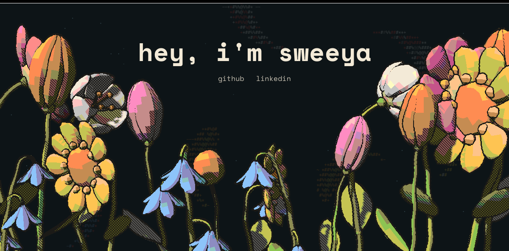

[site](https://sweeya.vercel.app) · [linkedin](https://www.linkedin.com/in/sweeyya)

---

## about

i study computer science at georgia state (class of 2027). i like building ai systems, making video games, and drawing. i'm a huge minecraft fan, i play a lot of clash royale and brawl stars, and one piece is my favorite show.

## right now

- building **limontree**, a platform where teams capture, check, approve and publish the ai workflows their employees create
- researching communication efficient multi agent reinforcement learning at georgia state
- ai and product co-op at **kimberly-clark** starting january 2027 (after interning at **tanium** on their corporate ai team)
- vp of operations at [**progsu**](https://www.progsu.com), georgia state's largest student org

## projects

| | |
| --- | --- |
| [**spectr**](https://github.com/Spectr-Agent/Spectr) | an assistant that uses your computer for you, by text, call, facetime or iphone app ([site](https://spectr-web-six.vercel.app)) |
| [**neuromorf**](https://github.com/Sweeyya/neuromorf) | a compiler that runs spiking neural networks on intel loihi 2. 98.35% on mnist, 176 regression tests |
| [**clo**](https://github.com/Sweeyya/CLO) | a carbon aware llm router. 40% of traffic to haiku with no quality loss, carbon down 37.8% |
| [**piggy little**](https://github.com/Sweeyya/piggy-little) | a small rpg in gamemaker about a pig rescuing his family from wolves |
| [**sweeya**](https://sweeya.vercel.app) | this site: an ascii koi pond with a hand inked 3d garden and bees |

## toolkit

